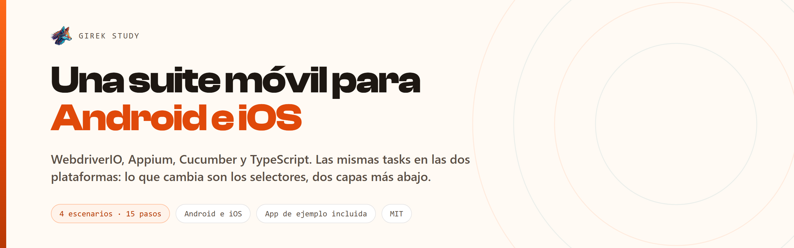

<p>
  
  
  
  
  
</p>

Framework de automatización móvil con **patrón Screenplay en capas numeradas**:
WebdriverIO, Appium, Cucumber y TypeScript. Una sola suite para Android e iOS, con la app
de ejemplo descargándose sola.

```bash
git clone https://github.com/Girek-Study/screenplay-mobile-bdd.git
cd screenplay-mobile-bdd
npm install
cp .env.example .env && cp .env.android.example .env.android
npm run app:descargar          # la app de ejemplo de WebdriverIO, 118 MB
npm run appium                 # en otra terminal
npm test
```

```
✓ Dado que Ana abre la pestaña de sesión
✓ Cuando ingresa como "valido"
✓ Entonces ve el diálogo "Success"
✓ Y el diálogo dice "You are logged in!"
…
1 passed, 1 total (100% completed) in 00:00:46
```

Verificado sobre un emulador Android API 36 con Appium 2.19 y la app de ejemplo v2.2.0.
Es la arquitectura que he usado en suites móviles de banca y retail, reescrita sobre una
app pública.

---

## La idea: una suite, dos plataformas

```
Framework/
  0001.Features/      el Gherkin, en español
  0002.Steps/         un solo archivo para Android e iOS
  0003.Actors/        quién ejecuta
  0004.Interactions/  pulsar, escribir, esperar, deslizar
  0005.Interfaces/    los selectores, y solo ahí se bifurca por plataforma
  0006.Models/        los datos
  0007.Tasks/         el lenguaje de negocio
  0008.Questions/     las aserciones
  0009.Utils/         configuración, ciclo de vida, evidencia
  0010.Runners/       el arranque
```

El orden de las carpetas es el recorrido de una prueba. Pero lo que de verdad define este
repositorio está en la capa 5.

**Lo que cambia entre Android e iOS es cómo se *nombra* un elemento, no lo que la persona
hace con él.** «Iniciar sesión» es la misma tarea en los dos sistemas. Así que la
bifurcación vive en los selectores y en ningún sitio más:

```ts
public static get tituloDialogo(): string {
  return porPlataforma({
    android: '//android.widget.TextView[contains(@resource-id, "alert_title")]',
    ios: '-ios predicate string:type == "XCUIElementTypeAlert"',
  });
}
```

Y arriba, una sola task para las dos:

```ts
export class IniciarSesion implements Ejecutable {
  async performAs(actor: Actor): Promise<void> {
    await actor.attemptsTo(
      Escribir.elTexto(this.datos.correo).en(PantallaSesion.campoCorreo, 'correo'),
      Escribir.elTexto(this.datos.clave).en(PantallaSesion.campoClave, 'clave'),
      Pulsar.en(PantallaSesion.botonIngresar, 'Ingresar'),
    );
  }
}
```

Duplicar la capa de tasks por plataforma es el error que convierte una suite móvil en dos
suites. No se desincronizan el primer día: se desincronizan en la tercera semana, cuando
alguien arregla un flujo en Android y nadie se acuerda de iOS.

## Las cinco trampas que este repositorio ya tiene resueltas

Cada una está comentada en el código, en el archivo donde muerde. Son las que me costaron
una tarde a mí, y las que cuestan una tarde a cualquiera.

**1. Los steps se importan de `@wdio/cucumber-framework`, no de `@cucumber/cucumber`.**
WebdriverIO arranca su propia instancia de Cucumber dentro del worker. Importar del
paquete de Cucumber registra los pasos en una segunda instancia que nunca corre, y la
suite muere antes de tocar el dispositivo:

> You're calling functions (e.g. "Given") on an instance of Cucumber that isn't running
> (status: PENDING). This means you may have an invalid installation…

El mensaje habla de una instalación corrupta. No lo es.

**2. Una sesión por archivo de feature, no por escenario.** Todos los escenarios de un
mismo `.feature` comparten el estado de la app. Un escenario que termina con un diálogo
abierto hace fallar al siguiente — y el error aparece en el escenario inocente, pulsando
un botón que el diálogo tapaba. Aquí se resuelve en `beforeScenario`, cerrando y
reabriendo la app:

```ts
await driver.execute('mobile: terminateApp', { appId: idApp });
await driver.execute('mobile: activateApp', { appId: idApp });
```

Dos órdenes, décimas de segundo. La alternativa, `noReset: false`, reinstala el paquete
entero y multiplica por diez lo que tarda la suite.

**3. El diálogo que parece del sistema y no lo es.** El de la app de ejemplo se dibuja con
AppCompat, así que su identificador lleva el paquete de la aplicación —
`com.wdiodemoapp:id/alert_title`— y no el `android:id/alertTitle` que aparece en todos los
tutoriales. Por eso el selector usa `contains`: sigue valiendo si la app cambia de paquete,
y vale igual si un día pasa a ser nativo.

**4. El teclado tapa el botón.** En Android, tras escribir, el teclado cubre la mitad
inferior de la pantalla y el clic siguiente aterriza sobre una tecla. La interacción de
escribir lo cierra ella misma:

```ts
if (driver.isAndroid && (await driver.isKeyboardShown())) {
  await driver.hideKeyboard();
}
```

Es el fallo más común de una suite móvil, y además solo se reproduce en algunos tamaños de
pantalla, que es lo que lo hace desesperante.

**5. `touchAction` ya no existe.** Quedó obsoleto en WebdriverIO v8 y lo eliminaron en la
v9, pero las guías que circulan por internet lo siguen usando. El deslizamiento de aquí
está escrito con la API de acciones W3C, `performActions`.

Y una sexta que no es de ejecución sino de compilación: en la v9 **`autoCompileOpts`
desapareció** y el tipo de una configuración es `WebdriverIO.Config`, no
`Options.Testrunner` —este último no incluye `capabilities`—. Una configuración copiada de
un ejemplo de la v8 arranca pero no pasa `tsc --noEmit`.

## Configuración en capas

```
.env            lo común del proyecto
.env.android    lo propio de Android      ─┐ se versionan como .example
.env.ios        lo propio de iOS          ─┘
.env.local      lo de tu máquina: tu UDID, tu dispositivo  ← no se versiona
```

El primero que define una variable gana, y `.env.local` carga primero. Sin esta
separación, el `.env` del repositorio acaba pisado en cada `pull` por el UDID de quien
hizo el último commit.

La configuración del dispositivo se lee **de forma perezosa**: pedir el bundle de iOS al
arrancar una corrida de Android hacía fallar la suite por una variable que esa ejecución
no iba a usar nunca.

## Comandos

| Comando | Qué hace |
|---|---|
| `npm run app:descargar` | Baja la app de ejemplo (Android). `:ios` para la otra. |
| `npm run appium` | Levanta Appium con `--relaxed-security`. |
| `npm test` | Toda la suite, en la plataforma del `.env`. |
| `npm run test:android` / `test:ios` | Fuerza la plataforma. |
| `npm run test:smoke` | Solo `@smoke`, sin `@wip`. |
| `npm test -- --tags "@regresion"` | Cualquier expresión de etiquetas. |
| `npm run typecheck` | `tsc --noEmit`. El worker corre sin chequear tipos. |
| `npm run unit` | Las unitarias de las utilidades del framework. |

El runner acepta las mismas cuatro formas de pasar etiquetas que el repositorio web, y
resuelve el binario de WebdriverIO subiendo por el árbol hasta su `package.json`: el
paquete declara `exports` y solo expone su raíz, así que `require.resolve` de cualquier
subruta falla con `ERR_PACKAGE_PATH_NOT_EXPORTED`. Los `.cmd` de `node_modules/.bin`
tampoco valen, porque no existen fuera de Windows.

## Requisitos

- Node 20+
- Un emulador o dispositivo Android con depuración USB, o un simulador de iOS
- Appium 2 con el driver `uiautomator2` (es dependencia del proyecto) o `xcuitest`
- Java y el SDK de Android en el `PATH` para Android; Xcode para iOS

La app de ejemplo es la [native-demo-app de WebdriverIO](https://github.com/webdriverio/native-demo-app)
(Apache-2.0). Existe para las dos plataformas, y esa simetría es justo lo que hace falta
para demostrar que una misma suite corre en ambas.

## Cuándo no usar esto

Si tienes una sola plataforma y menos de 50 pruebas, Page Objects te dará lo mismo con
menos archivos. El valor de Screenplay aquí aparece cuando Android e iOS comparten flujos
y el equipo necesita que la estructura imponga el orden.

## Licencia

MIT. Úsalo, cámbialo, llévatelo a tu proyecto.

---

Hecho por [Giancarlo Palomino](https://girek-study.com) — QA Lead / SDET.
La misma arquitectura para web está en
[screenplay-web-bdd](https://github.com/Girek-Study/screenplay-web-bdd).
