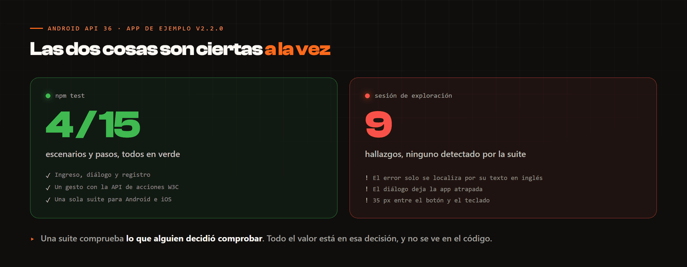

# El trabajo de calidad, antes del código

Un repositorio de automatización enseña **cómo** se automatiza. No enseña **qué** se
decidió probar, ni por qué, ni qué se dejó fuera. Esta carpeta es esa parte.

Está escrita sobre la app de ejemplo de WebdriverIO, la misma contra la que corre la suite,
y **desde fuera**: volcando el árbol de vistas con `uiautomator` en un emulador Android
API 36, sin leer su código. Es la situación normal de quien automatiza una app ajena.

| Documento | Qué contiene |
| --- | --- |
| [1. Análisis funcional](01-analisis-funcional.md) | Las trece reglas de la aplicación, ninguna escrita en ningún sitio, y las cuatro cosas que el árbol de vistas dice y nadie mira |
| [2. Diseño de casos](02-diseno-de-casos.md) | Partición de equivalencia, valores límite, tabla de decisión, transición de estados — y la matriz de plataformas, que en web no existe |
| [3. Matriz de trazabilidad](03-matriz-trazabilidad.md) | 17 casos diseñados, 4 automatizados, y el motivo de cada uno de los 13 que no |
| [4. Análisis de riesgos](04-analisis-riesgos.md) | Qué se automatiza, qué se baja a prueba unitaria y qué no se prueba |
| [5. Hallazgos](05-hallazgos.md) | Nueve, con pasos de reproducción |

---

## El resultado incómodo

La suite de este repositorio pasa **4 escenarios y 15 pasos en verde** sobre un emulador
Android API 36. La aplicación que prueba tiene **nueve hallazgos**, y el más caro es un
mensaje de error que ni una prueba puede localizar de forma estable ni un lector de pantalla
anuncia.

Las dos cosas son ciertas a la vez, y no es una contradicción: **la suite comprueba lo que
alguien decidió comprobar**. Los nueve hallazgos aparecieron en una sesión de exploración,
probando lo que ningún escenario probaba.

De ahí sale lo único que de verdad quiero que se lea de esta carpeta:

> Una suite en verde no dice que el producto esté bien. Dice que lo que se decidió
> comprobar, se comprueba. Todo el valor está en esa decisión, y esa decisión no se ve en
> el código.

## Y una segunda cosa, específica de móvil

La matriz dice **4 escenarios automatizados de 17 casos diseñados: un 24 %**. Es la mitad
de lo que cubre el
[repositorio web](https://github.com/Girek-Study/screenplay-web-bdd/blob/main/docs/03-matriz-trazabilidad.md)
y está así a propósito.

**Un escenario móvil cuesta entre diez y veinte veces más que uno web.** La suite web
entera corre en 8 segundos; estos cuatro escenarios tardan 46. Con esa relación de costes,
la pirámide de pruebas deja de ser un diagrama de presentación y se convierte en una
restricción de presupuesto: el extremo a extremo se reserva para lo que **solo** se puede
comprobar en un dispositivo.

Una validación de formato de correo no es una de esas cosas. Subir la cifra añadiendo esos
casos haría el número más bonito y la suite peor.

Por eso estos cinco documentos van antes que los `.feature` en el orden de lectura, aunque
en el repositorio aparezcan después.
